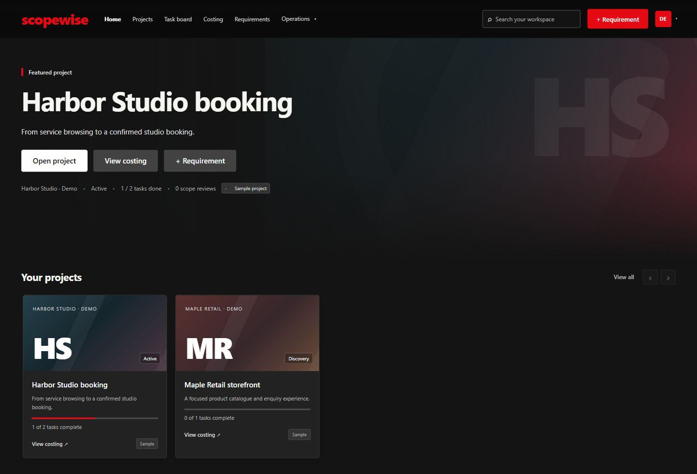
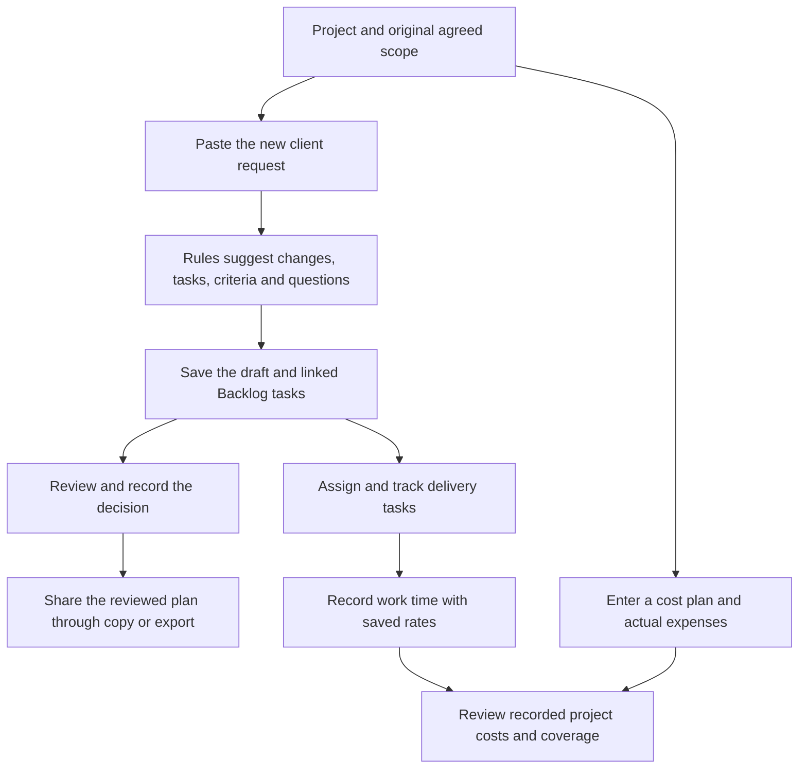
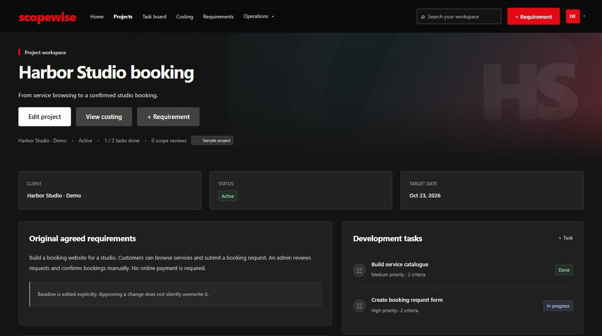
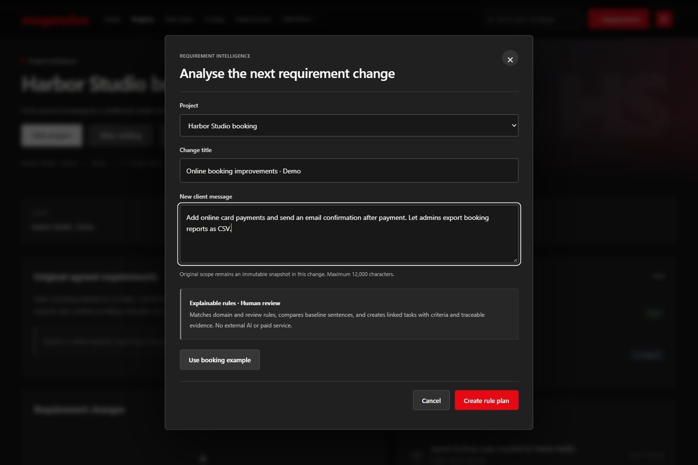
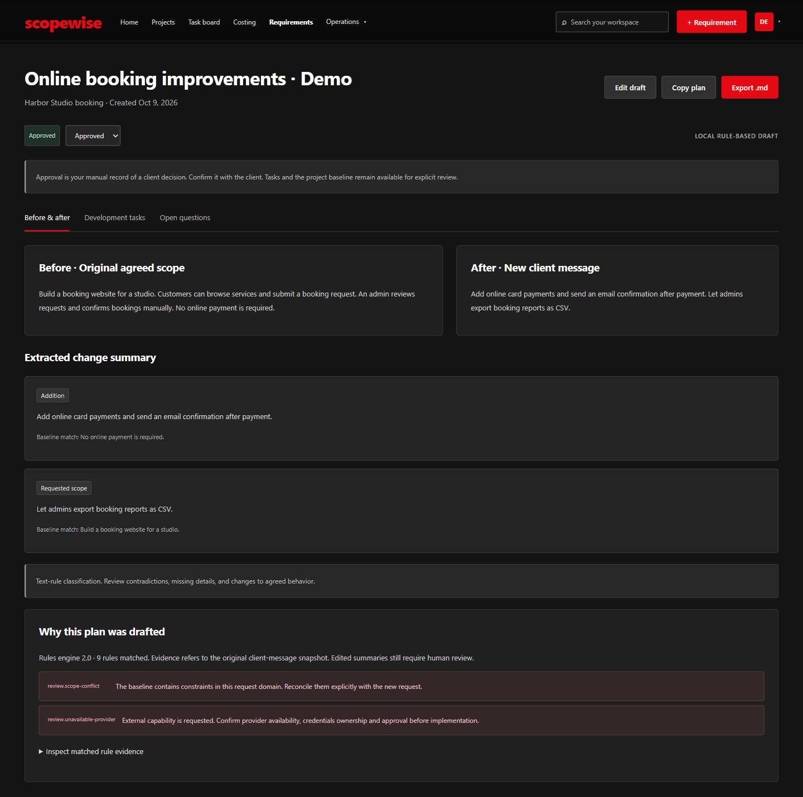
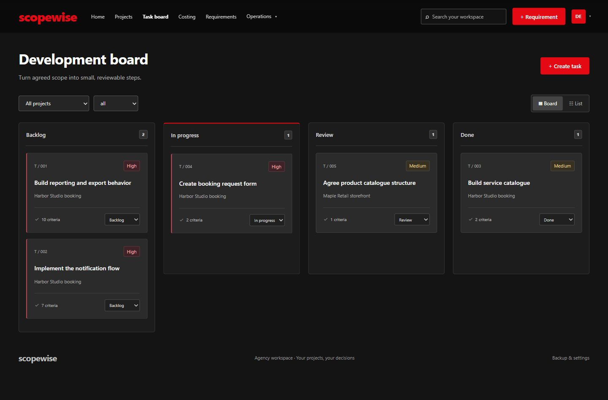
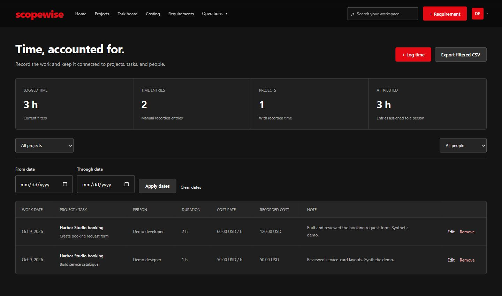
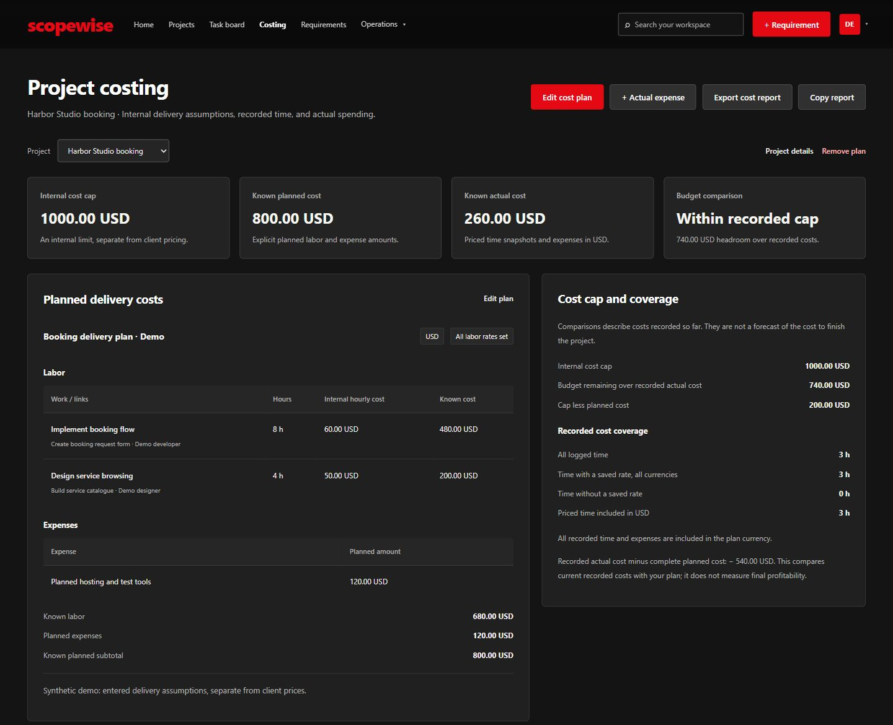
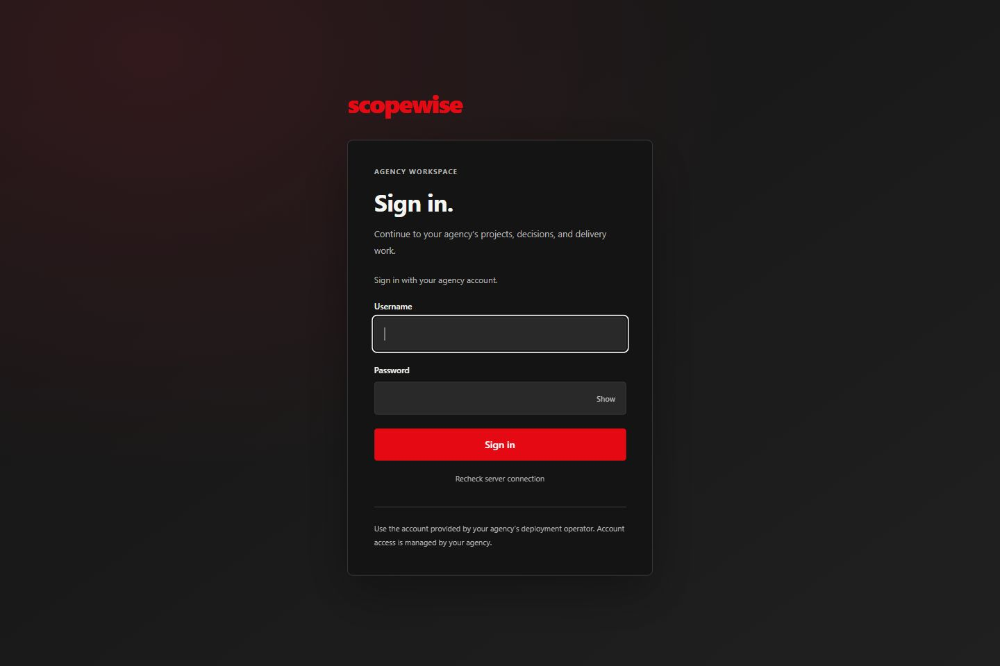
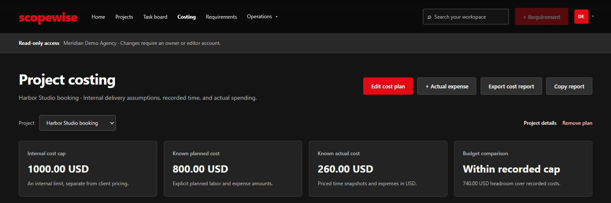

<div align="center">

# Scopewise

### Turn client changes into clear delivery work.

A shared agency workspace for project scope, tasks, people, time and internal costs.

**Version 3.0** · **48 explainable planning rules** · **No AI provider or API key**

[Open Scopewise](https://scopewise-tanvir284.netlify.app) · [Take the tour](#follow-one-project-from-request-to-delivery) · [See what connects](#one-workspace-connected-records) · [Run it locally](#run-your-own-workspace) · [Deployment](#put-it-online)



*The running app, using fictional projects in Meridian Demo Agency. All screenshots in this README use fresh synthetic data.*

</div>

## Keep the next “Can we also add…?” connected to the work

A client asks for online payments after agreeing to a simple booking form. Someone must check the original agreement, identify the extra work, ask the missing questions and keep delivery and costs visible.

Scopewise keeps those records together. Paste the new request, review a rule-based draft, record the decision, and work through linked tasks. Add people, manual time entries and expenses to see what the project has cost so far.

Agency owners can review delivery and internal spending. Sales teams can keep opportunities, proposals and client price drafts alongside projects. Delivery coordinators and HR colleagues can plan people and capacity. Developers can work from tasks, acceptance criteria and the client message that prompted them. Everyone uses the same project story.

**Current status:** [Scopewise is live](https://scopewise-tanvir284.netlify.app) on Netlify Free with a Node 24 API Function and Neon Free PostgreSQL. Sign-in requires an account supplied by the deployment operator. Hosted access, agency isolation, persistence after redeploy and a quiet interval, and real database recovery checks passed on 15 October 2026. The [16 October QA pass](docs/qa-2026-10-16.md) adds fixes, connected-feature checks, browser tests and bounded pressure results. See [verification](docs/verification.md) for evidence and practical limits. No Docker setup is required.

## Follow one project from request to delivery

This tour follows **Harbor Studio booking**, a fictional studio website. Screenshots show saved records and real app screens; they are not design mockups. A new installation starts empty.



*These arrows show how people use the app. Saving a draft creates tasks immediately; approval is a separate review record.*

### 1. Start with what was agreed

Create a client and a project. Write the original scope, set its status and target date, and keep the existing tasks beside it.

In this example, customers browse services and submit booking requests. An admin confirms each booking manually. **No online payment is required.** That sentence matters when the client later asks for card payments.



*The project keeps its original agreement visible. Editing the baseline is an explicit action that records a requirement version.*

### 2. Capture the new client message

Choose **+ Requirement**, select the project, give the change a title and paste the client's words. Then choose **Create rule plan**.

> Add online card payments and send an email confirmation after payment. Let admins export booking reports as CSV.



*The planner uses the project's agreed scope and this message. It runs locally in the backend without calling an AI service.*

### 3. Review the draft and settle the questions

The review page puts the original scope beside the new message. It shows extracted changes, linked development tasks, acceptance criteria, questions and the matched rule evidence.

For this exact example, nine rules matched. The result includes a warning about the payment restriction in the baseline and a reminder to confirm external provider availability. The planner grouped the two message sentences into two tasks; review the titles and criteria before using them.

| What went in | What came out in this demo |
| --- | --- |
| Original scope with no online payment | A scope-conflict warning for human review |
| Card payments and email confirmation in one sentence | “Implement the notification flow,” with payment and notification criteria |
| Admin CSV booking reports in the second sentence | “Build reporting and export behavior,” with access, report and booking criteria |
| Missing implementation details | Questions about the payment provider, currency, refunds, recipients, roles and report fields |

For example, a payment criterion asks for server-side provider verification before marking a transaction successful. A report criterion asks for the same authorized filters in the screen and the export. These are suggestions to edit and confirm, not a complete specification.



*Approved is a manually entered record of a decision. The app does not contact the client or silently rewrite the project baseline.*

Choose **Draft**, **In review**, **Approved** or **Declined** after the relevant conversation. Editing an approved or declined summary returns it to review. Copy or export the plan as Markdown when you need to share it yourself.

### 4. Plan and track the delivery work

The two suggested tasks are already in **Backlog** when the requirement draft is saved, before approval. Open each task to review its description and criteria, set its due date and update its status. Use Delivery → Task planning → Plan to add an assignee and effort estimate.

The board uses **Backlog → In progress → Review → Done**. You can also create tasks manually and filter by project or status.



*New requirement tasks stay linked to their project and change. Status changes, assignments and effort estimates are entered by people.*

Use sprints to group tasks, milestones for delivery checkpoints and issues for blockers. Completing a sprint does not automatically mark its tasks Done.

### 5. Connect people and recorded time

Team records hold a person's role, planning capacity and internal hourly cost. Assign tasks and manually log work against a project, task and person. Date and person filters help you inspect the time journal; filtered records can be exported as CSV.



*This example records two developer hours and one designer hour. Each entry keeps its saved rate, so a later change to the person's rate does not reprice earlier work.*

Team planning records are separate from sign-in accounts. Capacity is entered manually; this workspace does not provide payroll, recruitment or automatic scheduling.

### 6. Review the internal delivery cost

Enter planned hours and internal rates, planned expenses and an optional internal cost cap. Record actual expenses separately. The costing page combines explicitly priced time with actual expenses while showing how much of the recorded work is covered.

| Demo record | Calculation | Result |
| --- | --- | --- |
| Planned labor | 8 h × 60 USD + 4 h × 50 USD | 680 USD |
| Planned expenses | Hosting and test tools | 120 USD |
| Known planned cost | 680 + 120 | **800 USD** |
| Recorded labor | 2 h × 60 USD + 1 h × 50 USD | 170 USD |
| Actual expenses | Recorded hosting invoice | 90 USD |
| Known actual cost | 170 + 90 | **260 USD** |
| Headroom under the internal cap | 1,000 − 260 | **740 USD so far** |



*The cap, cost plan and recorded spending are separate inputs. The comparison describes costs recorded so far, not the cost to finish.*

A missing rate stays unknown; an explicitly entered zero stays zero. Currencies remain separate without conversion. Unpriced time or recorded costs outside the plan currency can make the cap comparison unavailable. Client estimates and invoice drafts hold client prices separately; the app does not calculate final profit, charge payments or automatically turn an estimate into an invoice.

### 7. Keep the record useful through delivery

Review task progress, milestones, issues, time and cost coverage together. Keep proposals, estimates and invoice drafts current when the commercial agreement changes. Use reports and exports to share records yourself, and maintain backups for recovery.

Scopewise preserves the link between the request and the work. People still make the agreement, decide readiness and record completion.

## One workspace, connected records

| Area | What you can do | How it connects |
| --- | --- | --- |
| Home and projects | Browse project cards, search and open a project workspace | A project brings together its client, scope, changes, tasks, activity and costs |
| Clients | Keep client records and contact details | Projects and sales records can reference a client |
| Requirements | Compare the original scope and new request; review evidence and decisions | Saving a rule plan creates linked tasks and keeps source snapshots |
| Task board | Review criteria and update delivery status | Tasks reference projects and may reference a requirement change |
| Sprints, milestones and issues | Group work, record checkpoints and track blockers | Records link to their project; sprint membership uses task links |
| Team and time | Enter roles, capacity and rates; record and filter manual time | Assignments and time link people to projects and tasks |
| Costing | Enter delivery assumptions and expenses; inspect recorded cost coverage | Uses saved time-rate snapshots and project expense records |
| Opportunities and proposals | Track sales stages and proposal drafts | Required client links and optional opportunity/project links keep context visible |
| Estimates and invoice drafts | Record client-facing price lines and draft statuses | Each is an independent project record; there is no automatic conversion or payment execution |
| Reports and settings | Inspect summaries, export records and manage workspace backups | Saved agency data stays together; owner-only backup merge preserves existing IDs |

Changing an opportunity to Won or a proposal to Accepted does not create a project or send anything. Statuses are human-entered records throughout the app.

## Shared work, clear access

Each account belongs to one agency. The server selects the agency from its authenticated session. Local mode uses separate SQLite databases; hosted mode binds agency workspaces and history in PostgreSQL.

| Account role | What it can do in its agency |
| --- | --- |
| Owner | Read, edit, create rule plans and explicitly merge workspace backups |
| Editor | Read, edit and create rule plans |
| Viewer | Read and export saved records; workspace, planner and import writes are denied |

**Viewers can see the whole agency workspace, including internal costs.** There are no per-project, per-field or client-portal permissions. Give this role only to people who should see that agency's records.

<details>
<summary><strong>See sign-in and viewer access</strong></summary>



*Accounts are provisioned by the deployment operator. A fresh installation has no default password or public signup.*



*Viewer access includes cost visibility. Editing is blocked by role checks in the browser and server.*

</details>

The operator manages usernames, roles, password resets and access revocation through administration commands. An app owner account does not automatically grant access to the hosting provider or operator terminal. There are no invitation or password-reset emails.

Save or export pending work before signing out. Unsaved browser drafts belong to the current account and tab and are cleared when its session ends. Passwords are stored as salted hashes; sessions expire and can be revoked. Read [security](docs/security.md) for the implemented protections and limits.

## Run your own workspace

You need Git, a browser and **Node 24.11 or later within the 24.x series**. Local mode uses Node's built-in SQLite support. Run npm ci to install the PostgreSQL adapter and test dependencies.

1. Clone the source and open its directory:

   ```text
   git clone https://github.com/Tanvir284/scopewise.git
   cd scopewise
   npm ci
   ```

2. Create an agency:

   ```text
   node scripts/admin.cjs agency-create --name "Your agency"
   ```

   Copy the agency ID returned by that command. Use that actual ID in the next command.

3. Create the first owner account:

   ```text
   node scripts/admin.cjs user-create --agency "AGENCY_ID_FROM_CREATE" --username agency-owner --role owner
   ```

   The interactive terminal asks for a password privately and asks you to confirm it. Use 12–128 characters. Do not put a password in command arguments.

4. Start the app:

   ```text
   npm start
   ```

   On Windows PowerShell, use `npm.cmd start` if `npm` is blocked by script execution policy. Open [http://127.0.0.1:4173](http://127.0.0.1:4173) and sign in with the account you created.

5. Create your first client, then a project and its original agreement. Add a requirement change to try the workflow above. Add editors or viewers with the same `user-create` command and the appropriate `--role`.

Local use runs the pages and API in one Node process. You do not need to configure Vercel to try it. The screenshots' agency and sample records are not installed by these commands.

If you are bringing an existing legacy workspace, use the explicit adoption steps in [backup and restore](docs/backup-restore.md) before the new agency's first login. Existing records are never assigned to a new agency automatically.

## Put it online

The selected $0 setup uses **Netlify Free for static pages and a Node 24 API Function, plus Neon Free PostgreSQL**. Accounts, sessions and agency records persist across Function restarts and redeploys. The browser uses one HTTPS origin.

~~~mermaid
flowchart TD
    U["Browser: sign-in and workspace"] --> N["Netlify Free: static pages and Node 24 API Function"]
    N -->|"Session selects agency; saves use transactions"| P["Neon Free PostgreSQL"]
    P --> A["Accounts, password hashes and sessions"]
    P --> W["Agency workspaces, revisions and import snapshots"]
~~~

*[The live installation](https://scopewise-tanvir284.netlify.app) deploys from this repository's main branch. Its existing records and revision history are stored in Neon.*

Use the **[step-by-step free deployment guide](docs/zero-cost-deployment.md)** to operate the live installation or create your own, preserve SQLite records, provision users and configure backups.

Netlify currently provides 300 shared credits/month. Neon provides 1 GB/project (20 GB/account total), 100 CU-hours/project/month and 5 GB database egress/project/month. Either provider can pause at its quota. The guide explains current commercial eligibility, limits, backups and recovery with official sources. Continuous uptime and permanent free service are not guaranteed.

~~~text
npm run check:netlify
node scripts/postgres-admin.cjs --help
~~~

PostgreSQL operator backups cover accounts, all agency data, history and import snapshots. Restore requires an empty destination and invalidates sessions. Legacy records are never assigned to an agency automatically.

Older paid Render/Vercel templates remain in [deployment alternatives](docs/deployment.md). Render Free's ephemeral filesystem and expiring database do not meet the workspace's durability requirement.


## Checks and further reading

Run the checks from the project directory:

```text
npm test
npm run test:operators
```

On Windows, use `npm.cmd` for the same commands if needed. The main check runs eleven suites for planning, workspace data, storage, operations, costing, backend behavior, security and authenticated client behavior, PostgreSQL transactions, migration and the serverless API. The separate operator check covers provisioning, backup, restore and explicit legacy adoption. Local passing results do not replace hosted acceptance.

| Read next | What it explains |
| --- | --- |
| [Rule engine audit](docs/rule-engine-audit.md) | Deterministic planning rules, evidence and review limits |
| [Project costing](docs/project-costing.md) | Rates, currency handling, coverage and cost comparisons |
| [Operations model](docs/operations-model.md) | Relationships among delivery, people, sales and commercial records |
| [Security](docs/security.md) | Accounts, sessions, role checks and agency isolation |
| [Backup and restore](docs/backup-restore.md) | Workspace merge, SQLite backups and operator recovery |
| [Free deployment](docs/zero-cost-deployment.md) | Netlify/Neon setup, quotas, migration and recovery |
| [Deployment alternatives](docs/deployment.md) | Older paid native Render/Vercel configuration |
| [Verification](docs/verification.md) | Local test and browser-check evidence |

<details>
<summary><strong>Where the source lives</strong></summary>

| Path | Purpose |
| --- | --- |
| `public/` | Browser pages, styles and client behavior; the only frontend publish directory |
| `lib/` | Server authentication and configuration |
| `server.cjs` | Native Node server entry point |
| `scripts/` | Account administration, deployment setup and recovery commands |
| `tests/` | Automated behavior and security checks |
| `deployment/` | Native hosting configuration and environment examples |
| `docs/` | Guides and the synthetic screenshots used here |
| `work/` | Private local data, databases and intermediate files; ignored by Git |

</details>
